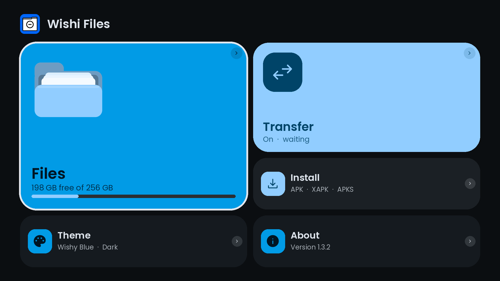
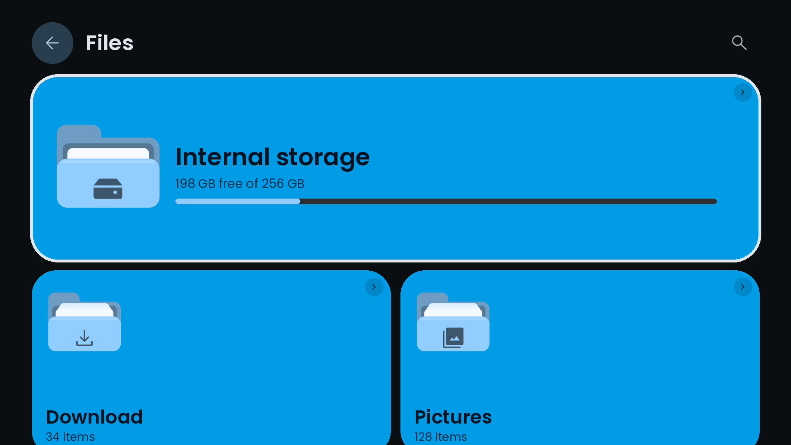
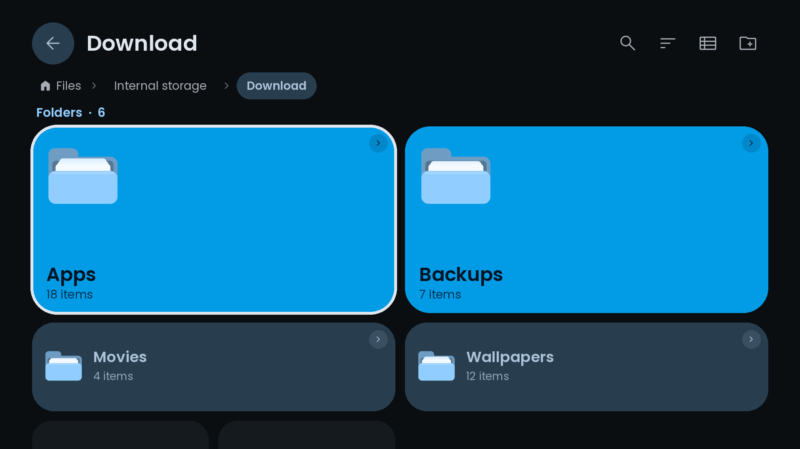
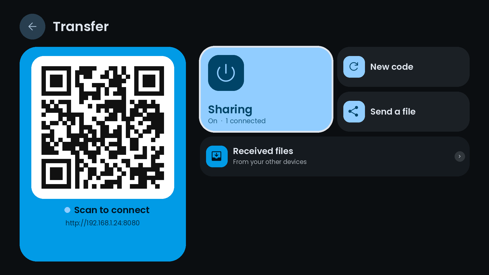

<div align="center">


# Wishi Files

**A tiny, private file manager for Android TV and phones.**

Browse storage, send files to and from any phone over your home Wi-Fi, and inspect APKs before you install them. No ads, no accounts, no cloud, and the whole app is under 200 KB.

<p>
  <a href="https://github.com/wishissue/WishiFiles/releases">Download</a> ·
  <a href="https://github.com/wishissue/WishiFiles/issues">Report a bug</a> ·
  <a href="https://github.com/wishissue/WishiFiles">Source code</a> ·
  <a href="https://wishissue.github.io/wishy-apps/donate.html">Donate</a>
</p>

<a href="https://wishissue.github.io/wishy-apps/donate.html">
  
</a>


</div>

---

## Screenshots

<div align="center">

<table>
  <tr>
    <td align="center" width="50%"><br><sub>Home</sub></td>
    <td align="center" width="50%"><br><sub>Storage</sub></td>
  </tr>
  <tr>
    <td align="center" width="50%"><br><sub>Inside a folder</sub></td>
    <td align="center" width="50%"><br><sub>Transfer</sub></td>
  </tr>
</table>

<sub>These are design previews rendered from the app's real theme colours, font and icons. Swap in device screenshots when you have them.</sub>

</div>

## Why Wishi Files?

Most TV file managers are heavy, ad-supported or awkward with a remote, and moving a file from your phone to a TV is still harder than it should be. Wishi Files keeps it small and clear.

- **Made for the remote.** Every screen works with a D-pad and with touch, and the layout scales from a phone to a 4K TV.
- **Folders you can read at a glance.** The folders you use most are the biggest and sit highest, like quick settings. An empty folder looks hollow, a full one shows papers peeking out.
- **Phone to TV with a QR code.** Scan it, pick files in any browser, done. No app on the other device.
- **Private.** No Google services, no telemetry, nothing leaves your network.
- **Open source** and built with plain Android views. No AndroidX, no libraries.

## Features

### Files
- Internal storage and USB drives, plus Downloads, Pictures, Movies, Music, Documents and Received shortcuts
- Folder tiles ranked by priority: how full a folder is, how often and how recently you open it. Empty folders are small and last
- Folders swing open as you enter them, with a zoom transition; Back zooms out
- Breadcrumb trail, search (recursive), sort by name, size, date or type, hidden files toggle
- Grid with previews (pictures, video frames, album art, APK icons, PDF first pages) or a plain list
- Multi-select, copy, cut, paste with progress and cancel, rename, delete, new folder, details
- Built-in viewers for pictures and for video and audio. Anything else opens in another app

### Transfer
- The TV hosts a small web page. Scan the QR code and send files from any browser, or download files you shared from the TV
- Resumable 4 MB chunks that survive Wi-Fi drops, Range downloads
- Random session code, lockout after repeated bad tries, auto-stop when idle

### Install
- Inspects APK, APKS, XAPK and APKM files with its own manifest parser
- Checks Android version, CPU, split APKs, target SDK, storage, downgrades and signature conflicts **before** installing
- Installs through Android's PackageInstaller (Android always asks you to confirm) and explains failures in plain language

### Look and feel
- Material 3 tonal tiles, Material Symbols icons, 45 colour themes in Dark, Light, Dusk and AMOLED
- Staggered tile entrance, focus zoom and ring, animated storage gauges, ripples on touch

## Install

1. Go to [Wishi Files Releases](https://github.com/wishissue/WishiFiles/releases).
2. Download the latest APK.
3. Move it to your Android TV or phone and open it. You may need to allow installs from the app you use to open the APK.
4. On first launch, allow file access. Android 11 and newer asks for **All files access**. If your TV has no settings page for it, the app shows an `adb` command you can run once.

## Build from source

### Requirements

- JDK 17 or newer
- `aapt`, `apksigner`, `zipalign`, `dalvik-exchange` and an API 23 `android.jar`

On Ubuntu:

```bash
sudo apt install aapt apksigner zipalign dalvik-exchange libandroid-23-java openjdk-21-jdk-headless
```

### Build the APK

```bash
git clone https://github.com/wishissue/WishiFiles.git
cd WishiFiles
./build.sh
```

The signed APK is written to `build/WishiFiles.apk`. A debug-grade keystore is generated on the first build in `tools/release.keystore`. Use your own key for releases.

There is no Gradle. That keeps the build dependency-free and the APK tiny.

### Rebuild the icons

Icons are Material Symbols Rounded, packed into one 22 KB asset.

```bash
npm i @material-symbols/svg-400
python3 tools/build_icons.py node_modules/@material-symbols/svg-400/rounded
```

## Privacy and security

Wishi Files does **not** collect anything. It has no analytics, no accounts and no network access except the transfer server you switch on yourself.

- Storage access is only used to browse, copy and save files you choose.
- The transfer server uses a random 128-bit session code that only appears in the QR code, constant-time comparison, a 5 minute lockout after 10 bad tries, and "New code" to lock out old links.
- Uploads go to one folder with sanitised names and never overwrite. Downloads only serve files you explicitly shared, by random id, never by path.
- Installing apps always shows Android's own confirmation. Nothing installs silently.
- Traffic is plain HTTP on your local network, so anyone who can see that traffic could read a transfer. The session code limits who can connect, but it is not encryption. Use trusted networks.

## Tests

Logic below the UI is tested on a desktop JVM and headless Chromium (see `tests/`).

| Area | Result |
|---|---|
| QR encoder vs OpenCV decoder | 4/4 decode |
| Transfer server (auth, traversal, resume, Range, lockout, idle stop) | 22/22 pass |
| Web page in Chromium: 12 MB upload with a dropped connection, shared download | byte-identical |
| APK parser vs `aapt dump badging` and crafted edge cases | all correct |
| File operations (copy, move, delete, collisions, cancel, search, sort) | 10/10 pass |
| Build: aligned and signed, `apksigner verify` v1/v2/v3 | OK |

## Known limitations

- **The Android UI has not been run on a device or emulator by its author yet.** The layers below it are tested as above. Expect first-run bugs, and please report them.
- The transfer server only runs while the app is open.
- Android 11 and newer needs "All files access". USB drives appear only when Android mounts them under `/storage`.
- No folder download, SMB, FTP or cloud. No animated GIFs or subtitles in the player.
- Bundle installs skip OBB data and install all non-ABI splits.
- Signature-conflict detection uses legacy signatures and may miss key-rotation cases. Android's own error is then explained.

If you run into a problem, open an [issue](https://github.com/wishissue/WishiFiles/issues) with your device model, Android version, what you did and what happened.

## Contributing

Bug reports, compatibility testing and screenshots from real devices are welcome.

1. Check the [existing issues](https://github.com/wishissue/WishiFiles/issues).
2. Describe the problem or improvement clearly.
3. Include device details and screenshots or logs when useful.

## Credits

- [Wishy Browser](https://github.com/wishissue/WishyBrowser): design language, themes and pages (GPL-3.0)
- [Material Symbols](https://fonts.google.com/icons): icons (Apache-2.0)
- [Material Color Utilities](https://github.com/material-foundation/material-color-utilities): the colour themes (Apache-2.0)
- [Poppins](https://fonts.google.com/specimen/Poppins): typeface (OFL-1.1)
- Studied for behaviour only, no code copied: Fossify File Manager, Aurora Store, dropX, android-wifi-fileserver

## License

GPL-3.0. See the [`LICENSE`](LICENSE) file.

---

<div align="center">

**Wishi Files: your files, on your TV.**

[GitHub repository](https://github.com/wishissue/WishiFiles) · [Releases](https://github.com/wishissue/WishiFiles/releases) · [Issues](https://github.com/wishissue/WishiFiles/issues)

</div>
